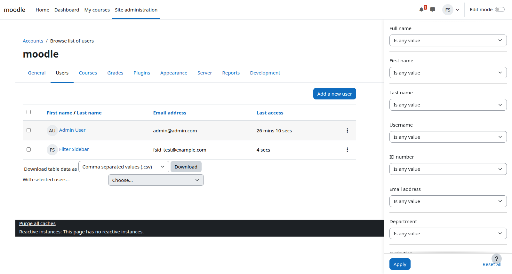

# local_userfiltersidebar

A small, presentation-only local plugin for the administrative user list
(`/admin/user.php`). On wide screens it moves the existing report builder
filter form out of its dropdown and presents it as a permanent, vertically
scrollable sidebar on the right-hand side of the screen.



This plugin is an extension of Moodle's existing user administration
interface. It does **not** implement any search logic, database access,
endpoints, web services, or background work: the filter form, its fields,
submission, reset, URL handling, permissions, pagination and sorting are all
provided and processed by the standard report builder as before.

## Behaviour

- Active from the Bootstrap `lg` breakpoint (viewport width ≥ 992px).
- The filter dropdown (`.filters-dropdown`) is rendered as a fixed sidebar:
  - width 360px (400px at ≥ 1200px), controlled by the
    `--userfiltersidebar-width` CSS custom property,
  - positioned below the top navigation bar (the theme's `--navbar-height`
    CSS variable is used, no fixed height assumption),
  - full viewport height with its own vertical scrollbar,
  - stacking order between page content and drawers/nav bar/modals.
- The main content (`#region-main-box`) is given matching right padding, so
  the user table, the "Add new user" action, and the bulk action form remain
  fully visible and usable.
- The now redundant "Filters" dropdown trigger button is hidden on desktop.
- The sticky "Apply/Reset" button row at the bottom of the filter form keeps
  working; all filter fields remain vertically arranged as in the original
  dropdown.
- Composite filter controls (date selectors, grouped operator/value
  selectors) are stacked vertically, and all labels, fieldsets, text inputs
  and selects use the full sidebar width.
- Below 992px (and in print media) the original Moodle dropdown behaviour is
  unchanged.
- The stylesheet is only loaded on the admin user list page (page type
  `admin-user`); no other page receives any markup, CSS, or JavaScript from
  this plugin.

## How it works

The plugin consists of exactly one hook callback and one stylesheet, and
changes nothing else:

- `db/hooks.php` registers the output hook
  `core\hook\output\before_standard_head_html_generation`.
- `classes/hook_callbacks.php` runs on every page but only acts when
  `$PAGE->pagetype` is `admin-user` (the page type of `/admin/user.php`);
  in that case it adds a single `<link rel="stylesheet">` tag to the page
  head, pointing at `styles.css` with a cache-busting `version` parameter.
- `styles.css` contains ~15 rules scoped to `body#page-admin-user` (the id
  Moodle assigns to the body tag on that page) inside
  `@media (min-width: 992px)`. They restyle the existing, server-rendered
  report builder filter DOM (`.filters-dropdown` and friends) into the
  fixed sidebar. No JavaScript is executed and no markup is altered.

Because the styling is scoped to that body id and media query, every other
page on the site is byte-for-byte unaffected (apart from the missing
stylesheet request, which the hook simply does not emit there).

## Supported versions

Tested against Moodle 5.0.4 (branch 500) and Moodle 5.1 (branch 501).
The declared minimum requirement is Moodle 5.0 (`$plugin->requires =
2025041400`); the head hook used
(`core\hook\output\before_standard_head_html_generation`) has existed since
Moodle 4.3, so older releases may work with minor adjustments.

Note the different plugin locations by layout:

- Moodle 5.0 and earlier: `local/userfiltersidebar/`
- Moodle 5.1 and later (with the `public/` directory layout):
  `public/local/userfiltersidebar/`

## Installation

1. Clone (or copy) this repository as the plugin directory:

   ```bash
   # Moodle 5.0 and earlier
   git clone https://github.com/univie-henrikjurek/moodle-local_userfiltersidebar.git \
       local/userfiltersidebar

   # Moodle 5.1 and later
   git clone https://github.com/univie-henrikjurek/moodle-local_userfiltersidebar.git \
       public/local/userfiltersidebar
   ```

2. Log in as a site administrator and run the upgrade
   (Site administration → Server → Database, or
   `admin/cli/upgrade.php` via CLI).
3. Purge all caches (Site administration → Development → Purge caches).
   The hook callback list is cached, so this step is required for the
   stylesheet to be emitted.

## Manual test procedure

On a desktop viewport (≥ 992px), as a user with `moodle/user:update`:

1. Open Site administration → Users → Account management → Browse users.
   The filter form is visible in a fixed sidebar on the right, the
   "Filters" dropdown button is gone, and the user table is not covered.
2. Scroll the page: the sidebar stays in place, the filter list scrolls
   independently, and the Apply/Reset row remains at the bottom of the
   sidebar.
3. Set one or more filter values and press **Apply**: the table reloads,
   the applied-filter count and toast behave as before, and the filter
   values are preserved on page reload.
4. Press **Reset all**: the form is cleared and the full list is restored.
5. Verify sorting, pagination, row actions, the "Add new user" button, and
   the bulk actions (select users, run a bulk action) still work.
6. Resize the window below 992px: the original "Filters" dropdown appears
   and works; the main content uses the full width again.
7. Open any other page (dashboard, course, other admin page): layout and
   behaviour are unchanged, and no `styles.css` request for this plugin is
   made.

## Known limitations

- In RTL deployments the sidebar stays on the right-hand side (the site
  should be LTR for the intended look).
- The filter panel's `aria-labelledby` attribute references the now-hidden
  trigger button on desktop; the panel itself provides no extra accessible
  name. All form controls keep their own labels and full keyboard access.
- The confirm-dialog responses served by `/admin/user.php` (delete,
  suspend, etc.) share the page type, so the stylesheet is loaded there
  too; it has no effect because no filter form is rendered on those
  responses.
- If the filter dropdown is opened on a narrow viewport and the window is
  then widened past 992px while the dropdown is still open, Bootstrap's
  Popper positioning may briefly offset the sidebar until the next
  outside click closes the (now redundant) dropdown. Reloading the page
  always restores the sidebar position.

## Maintenance

The stylesheet is cache-busted via the `version` query parameter derived
from the `CSS_VERSION` constant in
`classes/hook_callbacks.php`. Bump that constant (and the plugin version in
`version.php`) whenever `styles.css` changes so browsers fetch the new
file.

## License

Copyright (C) 2026 henrik &lt;henrik.jurek@univie.ac.at&gt;

Based on work originally inspired by a personal userscript that performed
the same presentation change.

This plugin is distributed in the hope that it will be useful, but WITHOUT
ANY WARRANTY; without even the implied warranty of MERCHANTABILITY or
FITNESS FOR A PARTICULAR PURPOSE. See the GNU General Public License (file
`LICENSE`) for more details.
